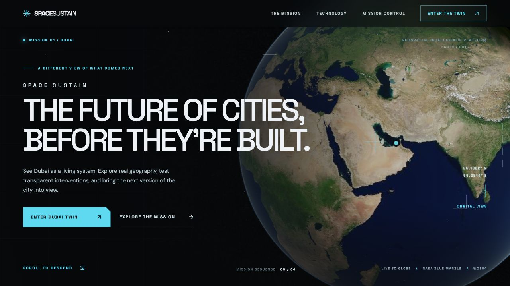

# SpaceSustain — Dubai Twin

**The future of cities, before they're built.**

[Live site](https://space-sustain.vercel.app/) · [Mission Control](https://space-sustain.vercel.app/mission-control) · [Source](https://github.com/tejaswi-raghav/space-sustain)

SpaceSustain is a cinematic geospatial prototype for exploring sustainability interventions in Dubai. It combines a real Cesium globe, NASA Blue Marble orbital imagery, mapped OpenStreetMap building footprints, district camera flights, a transparent solar calculation, and clearly labeled illustrative planning layers. The experience is designed for the Supernova WSW 2026 open innovation hackathon.

The V3 experience moves through **Observe → Understand → Engineer → The Future**. Its orbital camera makes a staged descent toward Dubai before opening Mission Control. On smaller screens, the district list and inspector become independent controls over the same interactive globe.



Visual comparison: [hero before](docs/v3-before-home.png) · [hero after](docs/v3-after-home.png) · [Mission Control before](docs/v3-before-mission.png) · [Mission Control after](docs/v3-after-mission.png).

## Explore the prototype

1. Enter the site and use **Enter Dubai Twin** to fly from orbit into the city.
2. In **Mission Control**, choose Al Quoz, Dubai Silicon Oasis, Business Bay, Dubai Marina, Expo City Dubai, or Jebel Ali. Drag to orbit and scroll to zoom.
3. Select a mapped building footprint. Open **Solar** to change usable roof area and shading assumptions and see the demonstration calculation update.
4. Toggle solar, heat, vegetation, and urban growth layers. Switch **Baseline / Proposed** to see concept rooftop, cool roof, planting, and infrastructure interventions.
5. Open **Data** to inspect the provenance and limits of the displayed geometry and overlays.

## What is real and what is illustrative?

| Element | Status | Source or method |
| --- | --- | --- |
| Globe, geography, coordinates | Real | CesiumJS WGS84 globe; Dubai district coordinates |
| Orbital imagery | Real composite | [NASA GIBS Blue Marble Next Generation](https://nasa-gibs.github.io/gibs-api-docs/access-basics/), shown at global scale |
| Streets and city imagery | Real map tiles | © [OpenStreetMap contributors](https://www.openstreetmap.org/copyright), ODbL; a stylized street-map view, not aerial photography |
| Bundled building footprints | Real mapped geometry | Small OSM API snapshots in `public/data/`, retrieved by `scripts/fetch_osm_buildings.py` |
| Building height | Mixed | OSM `height` tag where present; otherwise `building:levels × 3.2 m` or a 14 m *visual fallback*. The source is shown in the inspector. |
| Optional global 3D Buildings | Real 3D Tiles | Cesium OSM Buildings via Cesium ion, subject to an access token and its terms |
| Solar generation | Demonstration estimate | Explicit arithmetic and user-adjustable sample assumptions; **not building-specific feasibility** |
| Heat, vegetation, urban growth | Illustrative overlays | Concept shapes, **not satellite observations or measured conditions** |
| Future Mode interventions | Hypothetical | Visual comparison only; **no predicted climate or energy impacts** |

The roof footprint is a 2D OSM polygon, not a roof survey. Geometry, usable area, orientation, HVAC obstructions, shade, structural condition, grid connection, and irradiance must be validated before decisions. A shaded overlay is an interface demonstration and does not indicate actual heat, vegetation, or growth at the marked site.

## Stack

- Next.js App Router, React, TypeScript, Tailwind CSS
- CesiumJS globe and browser-only 3D scene; NASA orbital tiles, OSM city tiles, bundled Cesium workers and assets
- GSAP ScrollTrigger for the descent and chapter transitions; Motion for UI transitions
- Lucide icons; responsive panels; reduced-motion support
- GeoJSON snapshots from OpenStreetMap API, stored locally for reliable demo use

## Run locally

Requires Node.js 20.9+ and pnpm 11. The globe uses WebGL and network access to retrieve OSM base tiles.

```bash
git clone https://github.com/tejaswi-raghav/space-sustain.git
cd space-sustain
corepack enable
pnpm install
cp .env.example .env.local
pnpm dev
```

Open `http://localhost:3000`. The Cesium ion token in `.env.local` is **optional**. Without it, the site still renders a real globe and the bundled extruded OSM building footprints. To add global OSM Buildings 3D Tiles, set `NEXT_PUBLIC_CESIUM_ION_TOKEN` to a valid Cesium ion token and restart the server. A public client-side token should have the minimum asset access required for this demo. The UI shows the missing or failed token state in the **Data** tab.

```bash
pnpm typecheck
pnpm build
pnpm start
```

`postinstall` copies Cesium's `Assets`, `Workers`, `ThirdParty`, and `Widgets` into `public/cesium`. The copied directory is ignored in Git and is regenerated during the Vercel build.

## Solar model

The inspector computes:

```text
usable area (m²) = mapped footprint area × usable roof fraction
nameplate (kW)  = usable area × module efficiency × 1 kW/m²
annual energy (kWh) = usable area × annual irradiance (kWh/m²)
                    × module efficiency × performance ratio
                    × (1 − shading loss fraction)
```

Default **sample** assumptions: 60% usable area, 15% shade loss, 1,950 kWh/m²/year annual irradiance, 20% module efficiency, 0.78 performance ratio. These are scenario inputs, not measured values for any selected roof. See `lib/solar.ts`.

## Data provenance and refresh

The repository includes GeoJSON snapshots around Downtown and the six Mission Control districts. They were retrieved from the [OpenStreetMap API 0.6](https://wiki.openstreetmap.org/wiki/Api06). The script records retrieval time, OSM way IDs, tags, height source, and footprint area. To refresh them, run:

```bash
python3 scripts/fetch_osm_buildings.py
```

This makes seven small OSM API requests. Follow the [OSM API usage policy](https://operations.osmfoundation.org/policies/api/) and the [ODbL attribution and share-alike requirements](https://www.openstreetmap.org/copyright) when using or redistributing derived data. OSM mapping completeness varies; the snapshots do not represent every building in each district. Cesium ion tiles, if enabled, have separate access and attribution terms.

## Repository layout

```text
app/                  App Router pages, layout, and visual system
components/           Globe, cinematic home, and Mission Control
lib/                  District coordinates, layer metadata, solar math
public/data/          Licensed OSM building snapshots
scripts/              OSM fetch and Cesium static asset copy
.env.example          Optional client-side Cesium ion token
vercel.json           Vercel Next.js framework setting
```

## Deployment

The public Vercel project deploys from `main` at [space-sustain.vercel.app](https://space-sustain.vercel.app/). The Next.js build runs `scripts/copy-cesium.mjs` before compilation. If enabling optional OSM Buildings 3D Tiles in production, add `NEXT_PUBLIC_CESIUM_ION_TOKEN` in the Vercel project environment variables and redeploy.

## Roadmap

The next data milestone is a reproducible, dated satellite pipeline. Solar would use surveyed roof planes, shading, weather and performance models; urban heat would use calibrated land surface temperature and control sites; vegetation and growth would use cloud-screened optical or radar time series. Every result should expose its source, date, resolution, uncertainty, and review status. The current overlays intentionally do not imply those results exist.

## License

Application code: MIT, see `LICENSE`. OSM derived building data: ODbL; map tiles and Cesium content retain their respective licenses and attributions.
